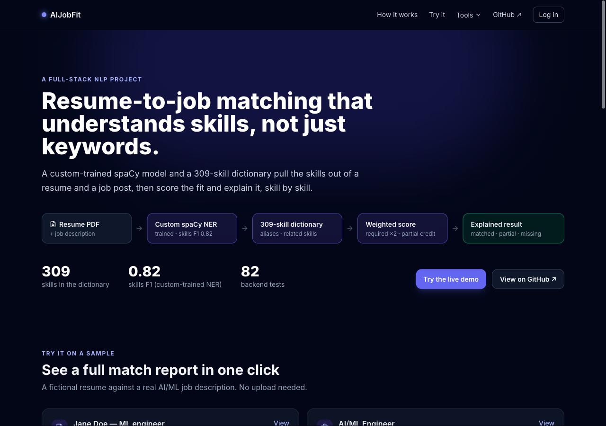
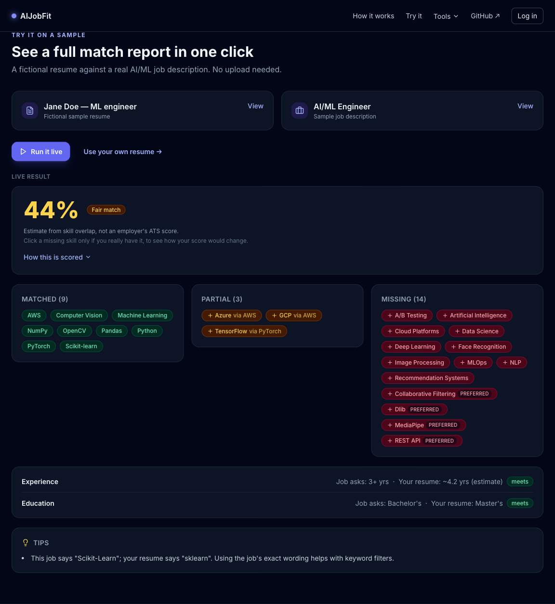
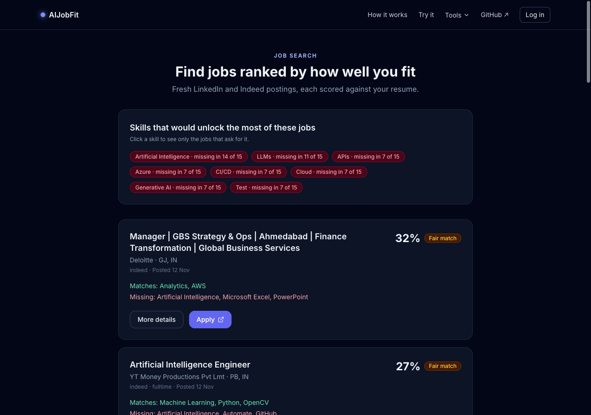

# AIJobFit

**Resume-to-job matching that understands skills, not just keywords.**

[Live demo](https://ai-job-fit.vercel.app) · [API docs](https://sreevardhan1729-aijobfit-backend.hf.space/docs) · [Backend on Hugging Face](https://huggingface.co/spaces/Sreevardhan1729/AIJobFit-Backend)



## What it does

- **Analyze a job description.** Required and preferred skills, the years of experience asked for, and education.
- **Compare a resume with a job.** A weighted match score with matched, partial ("TensorFlow via PyTorch") and missing skills. You can mark skills you really have to see the score change. It also shows experience and education fit, and wording tips ("this job says *Scikit-Learn*; your resume says *sklearn*").
- **Search jobs.** Fresh LinkedIn and Indeed postings, ranked by fit, plus the skills that would unlock the most of them.
- **Optional login** to save a resume for next time.

The home page has a live demo: run the match on a fictional sample resume, or edit the job description and drop in your own resume (it isn't saved). The **Find jobs for your resume** button goes straight to the job search.



## How matching works

1. **Find skills.** A custom-trained spaCy model (tok2vec + NER, skills F1 0.82) tags skills in the resume and the job post.
2. **Catch what the model misses.** A dictionary of 309 skills is scanned too, longest match first. Ambiguous words like "Go" or "Swift" are never scanned.
3. **Normalize.** Aliases collapse to one canonical name (ML / machine learning → Machine Learning, sklearn → Scikit-learn) without merging look-alikes: C, C# and C++ stay distinct.
4. **Score and explain.** Required skills are worth 1 point and preferred skills ½, detected from section headings and cues like "nice to have". Closely related skills earn half credit. The score is earned ÷ total, rounded the same way on the server and in the browser.

Experience and education are estimated and shown next to the score, but never change it. The score is an estimate from skill overlap, not an employer's ATS score.

## Architecture

```
React + TypeScript (Vercel)
        │  REST
        ▼
FastAPI (Hugging Face Space, Docker, Python 3.9)
   ├── spaCy NER model (custom-trained, stored with Git LFS)
   ├── app/matching/  pure-Python engine: skill dictionary, sections, experience, scoring
   ├── jobspy         LinkedIn / Indeed scraping
   └── MongoDB        accounts and saved resumes (GridFS)
```

**Stack.**
- **Frontend:** React 19, TypeScript, Tailwind CSS, Create React App, framer-motion.
- **Backend:** FastAPI, spaCy 3.8, PyPDF2, Motor (MongoDB), JWT auth.
- **Deploy:** Vercel (frontend) and Hugging Face Spaces (backend).



## Run it locally

### Backend

```bash
git clone https://huggingface.co/spaces/Sreevardhan1729/AIJobFit-Backend
cd AIJobFit-Backend
git lfs install && git lfs pull          # downloads the model weights
python3 -m venv .venv && . .venv/bin/activate
pip install -r requirements.txt
uvicorn app.main:app --port 7860
```

Settings come from an optional `.env` (see `.env.example`). Set `MONGODB_URI` to enable login and saved resumes. Without it, analyze, compare and search still work when you're logged out. `CORS_ORIGINS` defaults to `http://localhost:3000`.

### Frontend

```bash
cd frontend
npm install
npm start          # http://localhost:3000, calls http://localhost:7860 by default
```

Set `REACT_APP_API_URL` to use another backend (see `frontend/.env.example`).

## Tests

| Where | Command |
|---|---|
| Backend (82 tests) | `pytest` |
| Matching engine only, no spaCy or MongoDB needed | `python3 -m unittest discover -s tests/matching -t .` |
| Frontend components (Jest) | `CI=true npm test` |
| Frontend score logic (Node test runner) | `npm run test:logic` |

The home page's sample result is real API output. Regenerate it with:

```bash
cd frontend && python3 scripts/build_sample.py --capture https://sreevardhan1729-aijobfit-backend.hf.space
```

## Author

**Sree Vardhan Reddy** · [GitHub](https://github.com/Sreevardhan1729) · [LinkedIn](https://www.linkedin.com/in/sreevardhanreddy/)

## License

MIT. See [LICENSE](LICENSE).
